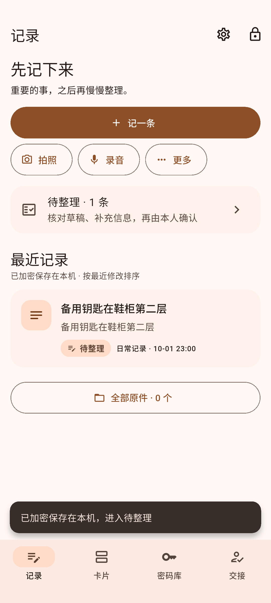
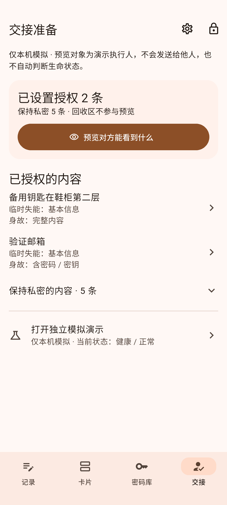

# LiveRelay · 留灯

记清自己的重要事情，提前准备交代给别人的信息。

留灯是一款个人重要事务记录与交接准备工具，用来整理账号、资料位置和家庭事项，保留信息来源，并提前核对本人暂时无法处理事务时，可以交代给别人的内容。

## 可以做什么

- **记录**：先保存一条内容，之后整理或本人确认；导入、拍摄和回看照片、录音及录像。
- **卡片**：按文字、类型和状态查找，查看完整来源与原件；编辑保留旧修订，支持拆分、组合、回收和恢复。
- **密码库**：默认遮挡密码，按需显示或复制，保留历史；支持 Edge CSV 导入和安全随机密码生成。
- **安全与恢复**：日常密码或已启用指纹任选，也可设置密钥文件及全部条件；独立恢复凭证可进入安全重设，变更安全材料时整库换钥。
- **手动交接**：独立接收者身份、完整指纹核对及私钥挑战；本人逐项选择记录、级别、历史和原件，签名加密交付，接收者只读查看。状态模拟单独保留。
- **备份与恢复**：完整加密备份或配对的数据库包／原件包；可先恢复数据库，再补齐原件。新版恢复先重设安全材料，旧备份仍可读取。
- **Agent 与语音**：可选 Responses Agent，外发检查及单次授权，结果先核对再保存；本地 SenseVoice 录音／WAV 转写，文字和原件关联保存。模型另行下载或导入。Linux 可选隔离 Bash。

| 记录 | 交接准备 |
| --- | --- |
|  |  |

界面示例使用虚构测试资料。[更多运行截图](work/paper/uiux-review-2026-10-01/截图索引.html)及 [验证证据](docs/60_quality/00_测试与验证策略.md)在仓库中保留。

## 下载和安装

Android 7 / API 24 及以上（发布包为 arm64）；另提供 Linux x86_64 完整应用包。安装制品通过 [GitHub Releases](https://github.com/BA2F/LiveRelay/releases) 分发，不放入 Git 源码历史。

| 里程碑 | 用途 | 发布页 |
| --- | --- | --- |
| v1.0.0-beta.1 | 当前推荐，桌面重建、云端搬运与合并导入；正式签名第一个版本 | [下载 APK、Linux 应用与校验文件](https://github.com/BA2F/LiveRelay/releases/tag/v1.0.0-beta.1) |
| MVP 0.4 | 上一版（调试证书签名），保留历史附件 | [历史 APK、Linux 应用与校验文件](https://github.com/BA2F/LiveRelay/releases/tag/mvp-0.4) |
| MVP 0.3 | 上一本机功能版，保留历史附件 | [历史 APK、Linux 应用与校验文件](https://github.com/BA2F/LiveRelay/releases/tag/mvp-0.3) |
| MVP 0.2 | 上一版侧载包 | [下载 APK 与校验文件](https://github.com/BA2F/LiveRelay/releases/tag/mvp-0.2) |
| MVP 0.1 | 首个可运行版本的原包归档 | [历史安装包](https://github.com/BA2F/LiveRelay/releases/tag/mvp-0.1) |

下载 APK 和同页的 `SHA256SUMS`，在下载目录执行 `sha256sum -c SHA256SUMS` 核对文件，然后在 Android 设备上安装。**v1.0.0-beta.1 起改用正式签名证书：从 MVP 系列升级需要卸载旧版再装新版，卸载会清除应用内资料库，请先在旧版导出整库备份（含原件），装好后恢复。** 此后各版本可以正常覆盖升级。“留灯·联调”verification 包与正常发布包分别保留资料。

Linux 下载 `LiveRelay-v1.0.0-beta.1-Linux-x86_64.tar.gz`，解压后运行其中的 `live_relay`；必须保留 `lib/` 和 `data/`，不能只复制可执行文件。从 Ubuntu22.04／glibc2.35 基线隔离构建，全部 ELF 的 ABI 已审计，最终包在 Ubuntu22.04 隔离环境完成启动验证。Linux 录音需 parecord／ffmpeg 及系统音频服务；服务密钥存储需会话 D-Bus 和已解锁 Secret Service。依赖、安装及已知缺口见[本版说明](docs/60_quality/releases/v1.0.0-beta.1.md)。

这些包标记为预发布（beta）。APK 内部版本与 Tag 名称分别记录，详情见 [版本记录](CHANGELOG.md)及各发布页。

## 开始使用

1. 创建加密资料库，设置密码，并离线保存、回输确认独立恢复凭证；已有 `.lvault` 时可进入恢复。旧库正常解锁后，可在安全设置主动升级。
2. 在“记录”选择“记一条”。“先保存”加密存入待整理；内容已核对时可明确确认保存。
3. 在“卡片”搜索、整理并回看来源；删除的内容可以到设置中的回收区恢复。
4. 定期导出加密备份，另存到设备外并实际验证恢复。独立恢复凭证单独保管；它可绕过日常解锁条件重设安全材料。指纹不能代替换设备恢复。
5. 在“我的”填写身份资料，核对并验证接收者身份；在真实手动交接中选择本次实际交付内容，预览后导出加密包。接收者从独立入口导入查看。

## 数据与隐私

结构化资料使用 SQLCipher 整库加密；主密码通过 Argon2id 派生，随机主密钥和原件使用 AES-256-GCM 保护。修订、来源和原件在本机保留。技术依据见 [安全设计](docs/30_design/security/00_安全设计总览.md)。

云 AI 默认未配置，每次调用均须检查并授权。被本人标记的敏感文字先替换为 Token；**未标记文字仍会按预览发送**。原图、音视频、Token Map 和其他资料库条目不交给 AI Provider。手工整理可以独立完成。

真实限定范围交接已提供本机手动加密包及独立接收者，不提供云端发放、远程撤回、现实状态核验或自动交接。独立调试演示需显式构建 `main_debug_demo.dart`，连点版本号七次展开面板，虚构资料与生产库隔离；下载的正常应用不含演示种子。实体生物识别/媒体硬件、真实 AI 服务及安全复核的完成情况以 [验证记录](docs/60_quality/00_测试与验证策略.md)为准。

## 开发与仓库导航

Flutter Android／Linux 应用在 [`work/code/live_relay/`](work/code/live_relay/)；安装开发环境、运行、测试和构建见 [应用开发说明](work/code/live_relay/README.md)。

| 位置 | 内容 |
| --- | --- |
| [docs/10_overview](docs/10_overview/) | 项目定位和系统总览 |
| [docs/20_product](docs/20_product/) | 产品设计 |
| [docs/30_design](docs/30_design/) | 架构、领域、来源、安全、AI 与交接设计 |
| [docs/40_modules](docs/40_modules/) / [docs/50_interfaces](docs/50_interfaces/) | 实现模块与内部端口映射 |
| [docs/60_quality](docs/60_quality/) | 验证策略、证据和版本制品记录 |
| [tasks](tasks/) / [handoffs](handoffs/) | 执行看板和交接事实 |
| [work](work/) | 应用源码、图示和报告成果 |
| [notes](notes/) / [records](records/) / [archive](archive/) | 讨论、决策原因和历史材料 |

开发协作先读 [AGENTS.md](AGENTS.md)。已确认设计是事实源；README 和发布页提供入口与输出视图，不另立一套产品契约。版本差异见 [CHANGELOG](CHANGELOG.md)，制品与发布约定见 [RELEASING](RELEASING.md)。

本项目采用 [MIT 许可](LICENSE)；「留灯 / LiveRelay」名称与产品图标不在授权范围内。
