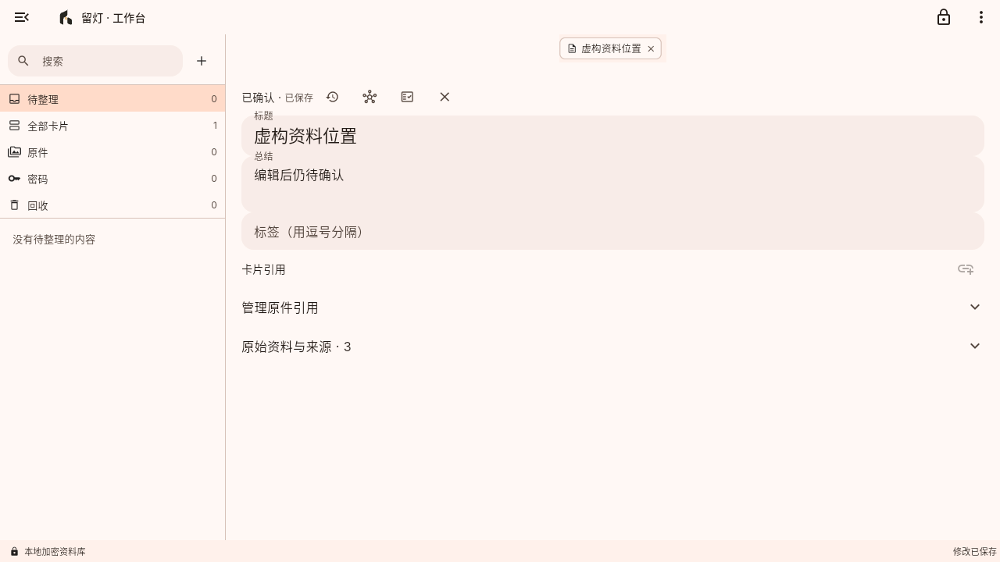

# 留灯 · LiveRelay

本地优先的重要事务记录与交接准备工具

[](LICENSE)


LiveRelay（留灯）用来记录那些需要长期保存、在关键时候又要交给别人的信息：账号在哪里、重要资料放在哪、家里的事怎么处理、哪些话要留给谁。资料保存在自己的设备上，由主密码保护；需要时，可以把选定范围内的内容加密交给可信的人。

## 功能

- **记录与原件**：随手记下一条内容，也可以拍摄、导入照片、录音和录像。原件单独加密保存，卡片始终能回到来源。
- **整理与修订**：按文字、类型和状态查找卡片；编辑保留历史修订，支持拆分、组合、回收和恢复。
- **密码库**：密码默认遮挡，按需显示或复制并保留历史；支持 Edge 密码 CSV 导入和安全随机密码生成。
- **安全与恢复**：日常可使用密码、指纹、密钥文件或组合条件解锁；独立恢复凭证可进入安全重设，更换安全材料时整库换钥。
- **本机与远程交接**：本机交接用长期密码打开只读快照，密码条目可交付账号、网址、备注和当前密码，卡片可附带原件；跨设备或云端取件仍用接收者独立身份，导入公开身份或手机扫码添加，核对完整指纹后导出签名加密的交付包。
- **备份与多设备**：导出完整加密备份，或分别导出数据库包和原件包；可通过磁盘、目录或 WebDAV 搬运整库，同一资料库的多台设备可以按修订合并导入。
- **本地语音**：使用 sherpa-onnx SenseVoice 在本机转写录音和 WAV 文件，转写结果与原件关联保存，模型可自行下载或导入。
- **可选 Agent**：接入 OpenAI Responses 兼容服务，外发前检查内容并授权，结果先核对再保存。Linux 上可选隔离 Bash。
- **桌面工作台**：左栏导航、对象标签页、状态条与右侧面板，支持右键菜单和快捷键。
- **云端摇篮**：可选部署的报平安与自动交接服务。本人定期上传签名记录，超期后服务按计划提醒本人并在宽限期后通知接收者取件；交付包以 HPKE 加密，服务端无法读取其内容。

## 界面

| Android | Linux |
| --- | --- |
|  |  |

截图中的资料均为虚构示例。

## 下载

安装包通过 [GitHub Releases](https://github.com/BA2F/LiveRelay/releases) 分发，不进入 Git 历史。

- **Android**：7.0 / API 24 及以上，arm64。最新版本 [v1.0.0-beta.4](https://github.com/BA2F/LiveRelay/releases/tag/v1.0.0-beta.4)。
- **Linux**：x86_64，glibc 2.35 及以上。最新版本 [v1.0.0-beta.4](https://github.com/BA2F/LiveRelay/releases/tag/v1.0.0-beta.4) 提供完整应用包。
- **Windows**：本版本提供源码支持（Windows 11 已验证构建、启动与首次建库），暂不提供 Windows 安装包。

每个发布页同时提供 `SHA256SUMS`，下载后可校验：

```bash
sha256sum -c SHA256SUMS
```

Linux 包解压后运行目录中的 `live_relay`，需要保留 `lib/` 与 `data/`。录音与转码需要 `parecord` 或 `ffmpeg`；系统密钥环需要已解锁的 Secret Service。

## 从源码运行

需要 Flutter stable（Dart 约束见 `pubspec.yaml`）。Android 另需 Android SDK 与 Java 17+；Linux 桌面需 GTK 与 libsecret 开发依赖。

```bash
cd work/code/live_relay
flutter pub get
flutter run -d <device-id>
```

构建发布包：

```bash
flutter build apk --release
flutter build linux --release
```

数据库生成文件已纳入源码。修改 Drift 表定义后重新生成：

```bash
dart run build_runner build
```

## 测试

```bash
cd work/code/live_relay
flutter analyze
flutter test
```

`test/` 覆盖领域规则、加密仓储、备份与恢复、Provider 边界及 Widget 行为。需要设备或桌面会话的端到端用例位于 `integration_test/`，运行方式见[应用开发说明](work/code/live_relay/README.md)。

## 项目结构

| 路径 | 内容 |
| --- | --- |
| [`work/code/live_relay/`](work/code/live_relay/) | Flutter 应用（Android / Linux） |
| [`work/deploy/`](work/deploy/) | 云端摇篮、copyparty / WebDAV 部署资产 |
| [`docs/`](docs/) | 产品、设计、安全与质量文档 |
| [`scripts/`](scripts/) | Linux 隔离构建等工具脚本 |
| [`work/artifacts/`](work/artifacts/) · [`work/paper/`](work/paper/) | 验证截图、报告与原型 |

技术栈：Flutter / Dart、Drift + SQLCipher、Argon2id、AES-256-GCM、sherpa-onnx、WebDAV，以及可选的 Python 云端摇篮服务。

## 文档

- [项目总览](docs/10_overview/00_项目总览.md)
- [产品设计](docs/20_product/00_产品设计总览.md)
- [安全设计](docs/30_design/security/00_安全设计总览.md)
- [测试与验证策略](docs/60_quality/00_测试与验证策略.md)
- [版本记录](CHANGELOG.md)
- [发布流程](RELEASING.md)

## 参与贡献

欢迎提交 Issue 和 Pull Request。改动请尽量聚焦单一问题；提交前请运行 `flutter analyze` 与 `flutter test`。涉及安全模型、数据格式或交接流程的改动，请先在 Issue 中说明设计。

## 许可

本项目采用 [MIT 许可](LICENSE)。「留灯 / LiveRelay」名称与产品图标不在授权范围内。
