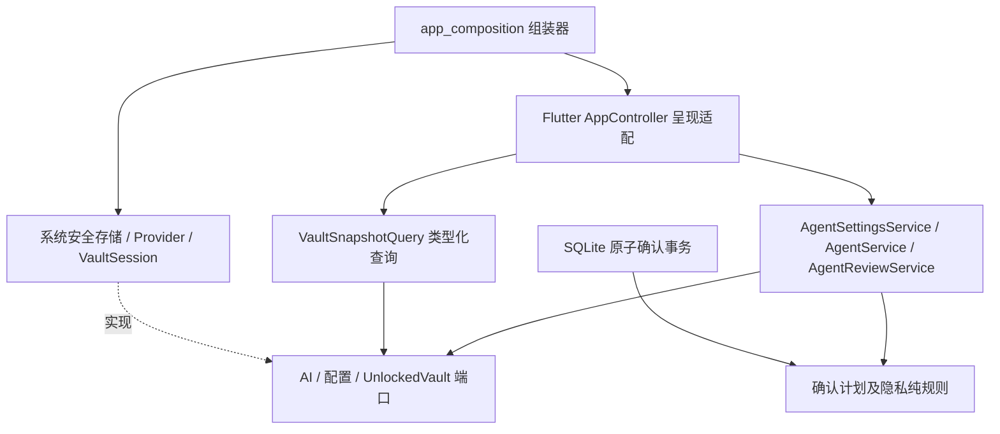

# 应用实现架构总览

> 状态：已确认\
> 版本：0.8\
> 最后更新：2026-10-07\
> 依赖文档：architecture/00_系统架构总览.md\

## MVP 技术基线

- Flutter 3.47.2 / Dart 3.13.2；
- 单个 Flutter package：`work/code/live_relay/`；
- Android 首发，`minSdk 24`、`targetSdk 36`；
- Material 3 表现层；
- 核心领域和端口使用纯 Dart，平台插件限制在基础设施层或组合根；
- SQLCipher与sherpa_onnx通过原生库／FFI进入运行链路；Android设备因素由Kotlin MethodChannel与Keystore CryptoObject实现；
- Python仅用于本仓库构建／验收工具，不作为App必须安装的运行时。

AppController实现位于presentation/controllers，是Flutter通知、忙碌状态、错误提示和既有页面入口适配器；application/app_controller.dart仅保留兼容导出。Agent配置、请求生命周期、明确确认保存、原件/OCR/CSV/语音落卡和整库资料查询已交给前端无关的Dart应用服务。VaultSession负责解锁会话和密钥生命周期，安全／备份／交接／接收者／语音仍由既有应用服务协作。AppController不持有VMK、不创建数据库，默认实例和平台路径由infrastructure/app_composition.dart装配。本轮没有把整个application目录声称为纯Dart：AgentConversation/工作台运行态/语音仍有Flutter状态依赖，备份/会话/安全服务仍有具体基础设施依赖。

## 工程目录映射

| 路径 | 职责 |
|---|---|
| `lib/presentation/` | Material 3页面、对话框、Design System及Flutter控制器适配；AppController保留现有手机/桌面入口 |
| `lib/application/` | 应用用例与查询、解锁会话；部分历史界面运行态尚未迁出，不能以目录名视为全部解耦 |
| `lib/core/domain/` | 卡片、凭据、原件、来源、生命状态和释放策略语义 |
| `lib/core/ports/` | Vault、OCR、AI、设备因素、语音与命令等内部替换端口 |
| `lib/core/security/` | 口令、Header／VMK封装、独立恢复、身份与交接加密逻辑 |
| `lib/infrastructure/` | SQLCipher、Blob、备份事务、OCR、AI、CSV、本地语音、Linux命令与Android适配器 |
| `lib/main.dart` | 正常应用入口，调用集中组合根，不承载业务规则 |
| `lib/main_debug_demo.dart` | 独立虚构演示入口，与正常资料库隔离 |

当前尚未为了“模块化外观”拆成多个 Dart package。先保持依赖方向和可替换端口，待出现独立复用或独立发布需求再物理拆包。

## 本轮已落实的依赖方向

- `AgentSettingsService`只依赖`AiSettingsRepository`：配置读取/保存/选择/删除/清除、配置代际及变更流。配置写入互斥和授权失效发生在用例内，不依赖Flutter的isBusy；写入失败也使旧核对范围失效。
- `AgentService`依赖AI端口、配置服务和`UnlockedVault`：管理一个网络槽、取消、配置/会话代际检查、文本/附件会话、Agent草稿与原件脱敏整理。网络等待不占本地编辑保存门；取消旧请求不会释放新请求的槽。状态通过纯Dart活动流交给呈现适配器。
- `AgentReviewService`转换明确确认/草稿并调用Repository原子操作；卡片、来源、收纳、引用、可见层级、首次计划和幂等回执仍在同一SQLite事务。
- `ReviewedAgentPlan`位于core/ai，属于领域规则：验证数量/来源一致性、保存计划和当前目标事实，固定输入集合。数据库在事务内读取目标，再调用规则；不把有效性检查搬到事务外。
- `VaultContentService`依赖`VaultOriginals`/`OcrProvider`：原件写入/注册失败补偿、按ID查询读取、OCR缓冲清零、CSV密码导入、语音落卡。锁库或换库后丢弃迟到明文/识别结果；同会话注册失败删除本次文件，换库后不按旧ID删除新库文件。CSV控制器忙碌门拒绝前的输入清零仍保留，密码值不被trim，语音默认仍草稿。
- `VaultOriginals`由VaultSession实现，应用用例接触原件字节而不接触VMK；SQL原件查询使用主键getBlob，不为一次读取加载全库元数据。
- CSV纯解析迁到application/import，旧infrastructure/import路径兼容导出，不把格式解析误作为平台基础设施。
- `AiProviderSettings`位于core/ai；平台存储实现兼容导出该类型，旧调用无需迁移。系统插件仅在AiProviderSettingsStore中，应用服务依赖内层端口。
- `VaultSnapshotQuery`返回类型化完整投影，集合结构不可改写；查询/响应核对会话代际，锁定或替换库后丢弃旧结果。不是数据库事务快照隔离保证，实体内的旧可变字段也没有据此宣称全部不可变。
- 旧格式备份安装仍在提交前校验查询，使用已认证Repository的内部校验入口；提交完成并标记解锁后才刷新界面，不绕过普通查询的解锁门。

普通Dart进程可直接执行`test/support/agent_service_headless_checks.dart`，验证上述服务和纯规则，不载入Flutter/UI、平台密钥存储或SQLCipher实现。真实SQL事务回滚、恢复流程及手机/桌面行为另由现有回归证明。

这形成了可直接复用的部分命令、类型化查询和事件能力，但并非全功能跨进程公共API。安全、备份等仍需继续收敛端口与用例；AppController中的这些编排暂保留，平台语音和工作台运行态也仍有Flutter依赖。切换到Rust/GPUI仍需另行设计版本化IPC/FFI及错误映射，不能直接消费Dart接口。本轮不拆多package、不改Header/schema、不迁移前端技术。

## 第三方依赖原则

成熟库优先，但关键数据格式、接口和迁移能力不能被单一小众库绑死。

MVP 关键依赖包括：

- `drift` + `sqlite3` SQLCipher：结构化加密存储；
- `cryptography`：Argon2id、AES-GCM、HKDF、HMAC；
- `flutter_secure_storage`：Provider配置的系统安全存储；`local_auth`及旧BiometricKeyStore保留兼容路径，新Header设备因素使用独立AndroidDeviceFactorProtection；
- `google_mlkit_text_recognition`：端侧中文 OCR；
- `image_picker`、`record`、`just_audio`、`video_player`：采集和回看；
- `http`：OpenAI-compatible HTTPS Provider与Responses Agent；
- `sherpa_onnx`：本地SenseVoice转写；
- `archive`：`.lvault` ZIP 容器。

后续依赖升级仍需记录：

- 版本；
- 许可证；
- 替代方案；
- 是否影响 LifeVault 格式。

## 当前边界与开放问题

- Android实际启用／解锁指纹、取消、换钥与恢复已在小米13验证；新录入指纹失效、全部因素／密钥文件与更多设备仍待验收；
- Linux本地短录音／WAV转写、来源草稿、加密存储、Secret Service和本次隔离Bash已实现；桌面相机／OCR等其他媒体、设备因素适配未据此视为完成；
- Linux候选在Ubuntu22.04隔离构建并审核ABI，宿主EndeavourOS现场试用通过；更多发行版／声卡／日常密钥环仍需验证；Windows代码入口已准备，尚未构建验收；
- `Application` 和 `core` 是否拆成独立 package，等待第二个客户端或独立复用需求；
- 大文件当前在内存中加解密，单个 Blob 限制 256 MB；流式加密未来可能需要 Native/FFI；
- `cryptography_flutter` 当前构建仍使用旧式 Kotlin Gradle Plugin 接入，未来 Flutter 升级前需要更新依赖。

本页记录当前实现和依赖，不冻结跨package公共接口。云端摇篮／同步、外部Agent／CLI／MCP、正式签名和安全复核仍待完成；现场证据见[实际联调验证](../../60_quality/2026-10-04_实际联调验证.md)。

## 历史来源

- `docs/10_platform/00_应用实现总览.md`
- `docs/10_platform/02_应用层职责.md`
- `docs/10_platform/09_依赖管理.md`
- `docs/10_platform/10_第三方库使用原则.md`
