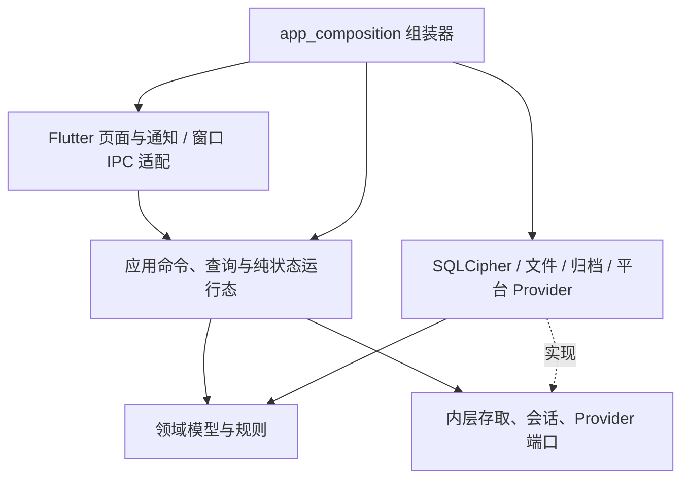

# 应用实现架构总览

> 状态：已确认\
> 版本：0.10\
> 最后更新：2026-10-08\
> 依赖文档：architecture/00_系统架构总览.md\

## MVP 技术基线

- Flutter 3.47.2 / Dart 3.13.2；
- 单个 Flutter package：`work/code/live_relay/`；
- Android 首发，`minSdk 24`、`targetSdk 36`；
- Material 3 表现层；
- 核心领域和端口使用纯 Dart，平台插件限制在基础设施层、明确的窗口/呈现适配或组合根；
- SQLCipher与sherpa_onnx通过原生库／FFI进入运行链路；Android设备因素由Kotlin MethodChannel与Keystore CryptoObject实现；
- Python仅用于本仓库构建／验收工具，不作为App必须安装的运行时。

AppController位于presentation/controllers，负责Flutter通知、页面投影、忙碌状态与错误提示。默认实现和平台路径由infrastructure/app_composition.dart装配；兼容application入口只导出旧类型。2026-10-08续接后，安全/备份、语音、持续对话、工作台状态、设备偏好和独立接收者均使用前端无关的Dart应用实现。VaultRecordsApplication提供卡片/凭据/原件/策略/状态的具名命令与查询，Controller保留原有手机/桌面调用形状；普通Dart可直接运行这些用例。VaultSession持有解锁会话和密钥，通过内层端口与实际SQLCipher/Blob/归档/安装/设备因素实现协作，页面及Agent不获得VMK。

当前仍是单一Flutter package，包含兼容导出和本机Directory/文件能力。这里的分层可验证，既没有冻结跨package公共协议，也没有实现Rust/GPUI桥接。大型Repository仍持有SQL事务、映射与部分待提取规则，不能仅按目录名称宣称所有历史代码均已达到严格分层。

## 工程目录映射

| 路径 | 职责 |
|---|---|
| `lib/presentation/` | Material 3页面、对话框、Design System及Flutter控制器适配；AppController保留现有手机/桌面入口 |
| `lib/application/` | 纯Dart应用用例、查询和状态运行态、解锁会话；旧Flutter入口仅兼容导出 |
| `lib/core/domain/` | 卡片、凭据、原件、来源、生命状态和释放策略语义；拆分/组合/引用及草稿纯规则 |
| `lib/core/ports/` | Vault生命周期/维护/原件/安装/归档、OCR/AI/语音、偏好/身份存取等内部替换端口 |
| `lib/core/security/` | 口令、Header／VMK封装、独立恢复、身份与交接加密逻辑 |
| `lib/infrastructure/` | SQLCipher、Blob、备份事务、OCR、AI、CSV、本地语音、Linux命令与Android适配器 |
| `lib/main.dart` | 正常应用入口，调用集中组合根，不承载业务规则 |
| `lib/main_debug_demo.dart` | 独立虚构演示入口，与正常资料库隔离 |

当前尚未为了“模块化外观”拆成多个 Dart package。先保持依赖方向和可替换端口，待出现独立复用或独立发布需求再物理拆包。

## 本轮已落实的依赖方向

- `AgentSettingsService`只依赖`AiSettingsRepository`：配置读取/保存/选择/删除/清除、配置代际及变更流。配置写入互斥和授权失效发生在用例内，不依赖Flutter的isBusy；写入失败也使旧核对范围失效；保存期间阻止新请求，写入/善后/回读失败停用内存发送配置，避免旧端点搭配新凭据。
- `AgentService`依赖AI端口、配置服务和`VaultLifecycle`：管理一个网络槽、取消、配置/会话代际检查、文本/附件会话、Agent草稿与原件脱敏整理。网络等待不占本地编辑保存门；取消旧请求不会释放新请求的槽。状态通过纯Dart活动流交给呈现适配器。原件敏感标记在凭据等待前固定；原件整理仅在两段本地写入时占用共享门，网络等待释放。
- `AgentReviewService`转换明确确认/草稿并调用Repository原子操作；卡片、来源、收纳、引用、可见层级、首次计划和幂等回执仍在同一SQLite事务。
- `ReviewedAgentPlan`位于core/ai，属于领域规则：验证数量/来源一致性、保存计划和当前目标事实，固定输入集合。数据库在事务内读取目标，再调用规则；不把有效性检查搬到事务外。
- `VaultContentService`依赖`VaultOriginals`/`OcrProvider`：原件写入/注册失败补偿、按ID查询读取、OCR缓冲清零、CSV密码导入、语音落卡。锁库或换库后丢弃迟到明文/识别结果；同会话注册失败删除本次文件，换库后不按旧ID删除新库文件。CSV控制器忙碌门拒绝前的输入清零仍保留，密码值不被trim，语音默认仍草稿。
- `VaultRecordsApplication`的具名命令统一卡片/凭据/原件/策略/生命状态写入与刷新；查询拒绝锁定/换库后的迟到结果。共用Session写入/维护门，不依赖UI的忙碌标志；文件输入在门拒绝时也清零，调用方集合先固定。Workbench编辑器直接调用此应用入口。
- `DevicePreferencesRuntime`依赖`DevicePreferencesRepository`；设备选择串行持久化，失败不声称已保存，损坏偏好不在已有库上启动新建。文件实现归基础设施、通知归AppPreferences适配；平台能力模型纯化，平台判定归组合根。
- `RecipientRuntime`依赖`RecipientStore`，独立密码/身份/信任/回执和HPKE用例不引入Flutter或文件API。文件恢复与目录操作归FileRecipientStore；格式/签名/披露校验归core/identity。门与取消代际覆盖创建/导入/解锁/接收，销毁使迟到结果失效，受验证视图深层只读；已开始的持久化可能完成，取消不会重新解锁或复活明文状态。
- `LocalHandoffService`依赖`VaultLifecycle`/`VaultOriginals`，不依赖具体Session类。身份初始化、资料保存、挑战/确认和限定交接占同一门；绑定与挑战消费通过Repository原子多值写入提交，字节格式和授权级别不变。
- `DraftRules`/`SplitCardPlan`/`BundleCardPlan`/`CardReferenceRules`为纯领域规则；Repository在事务内读取当前事实、校验并保存。回收区成员拒绝组合/确认；引用版本仍为workbench.references.v1。生命状态事件与审计在同一事务；没有把需要原子性的检查挪到事务外。
- `VaultOriginals`由VaultSession实现，应用用例接触原件字节而不接触VMK；SQL原件查询使用主键getBlob，不为一次读取加载全库元数据。
- `VaultMaintenance`/`VaultArchive`/`VaultInstallation`为本机内部端口；归档/安装事务由infrastructure实现和注入，错误与Header metadata在core。安全服务通过纯进度流发布状态；Session共享写入与维护门、同步撤销和销毁后的迟到打开拒绝。Directory与借钥仍属于特权本机维护边界，未成为页面/Agent或跨进程协议。
- `SpeechRuntime`只依赖语音/远程/配置端口和明确平台能力；原子配置/Key核对、回读失败停用、输入清零和本地/远程迟到取消在用例内。`SpeechService`为presentation/controllers通知适配，资源释放与平台默认在组合根。
- `ConversationRuntime`依赖已注入的`ConversationApplication`及纯消息/建议模型；直接复用Agent、审核、内容、类型化查询和会话能力。`AgentConversation`为Flutter适配；同步锁定清除对话、查询缓存和页面投影，网络不占本地写门，应用写门阻止并发维护。语音子窗口在写入前排空当前助手待保存内容；没有待保存编辑时不会新建或覆盖会话记录。明文String只能撤销引用，未宣称Dart堆字符串可以可靠物理清零。
- 工作台布局/编辑/扩展状态在application/workbench；扩展描述与不可变安装值在core/extensions；窗口主机/IPC/预览权限和WorkbenchRuntime在presentation。旧application路径仅兼容导出。编辑和布局的纯模型与Flutter通知适配分开；WorkspaceStateStore维持既有加密键/JSON版本与排队代际核对，扩展失败恢复原状态。
- CSV纯解析迁到application/import，旧infrastructure/import路径兼容导出，不把格式解析误作为平台基础设施。
- `AiProviderSettings`位于core/ai；平台存储实现兼容导出该类型，旧调用无需迁移。系统插件仅在AiProviderSettingsStore中，应用服务依赖内层端口。
- `VaultSnapshotQuery`返回类型化完整投影，集合结构不可改写；查询/响应核对会话代际；同步发布保证保存返回前投影可见，发布观察者锁定再次检查，旧请求不能覆盖较新投影；锁定、销毁或替换库后丢弃旧结果；销毁同步撤销unlocked状态，真实Session的借用密钥和迟到原件缓冲清零另有回归。不是数据库事务快照隔离保证，实体内的旧可变字段也没有据此宣称全部不可变。
- 旧格式备份安装仍在提交前校验查询，使用已认证Repository的内部校验入口；提交完成并标记解锁后才刷新界面，不绕过普通查询的解锁门。

普通Dart进程可直接执行`test/support/agent_service_headless_checks.dart`，验证上述服务和纯规则，不载入Flutter/UI、平台密钥存储或SQLCipher实现。真实SQL事务回滚、恢复流程及手机/桌面行为另由现有回归证明。

本轮形成具名记录命令/查询、对话/语音/偏好/身份/工作台运行态及纯Dart状态事件。66项普通Dart检查覆盖应用层实际调用，依赖门禁递归检查本仓库import/export，防止用例经兼容路径重新依赖Flutter/基础设施；这些检查也包含在285项Flutter回归中，不重复累计。真实数据库与桌面客户端仍另行验收。

仍需按业务逐个梳理Repository内的来源绑定/回收/OCR衍生等较长事务，以及纯状态对象的完整不可变性和公开错误契约。当前具名应用入口可供另一Dart前端复用；Rust/GPUI需要版本化IPC/FFI和生命周期/错误映射，Dart对象不是直接的Rust接口。本轮不拆多package，不改Header/schema/交接/归档格式，不迁移前端技术。兼容入口是过渡层，不应成为新增应用实现的依赖。

## 第三方依赖原则

成熟库优先，但关键数据格式、接口和迁移能力不能被单一小众库绑死。

MVP 关键依赖包括：

- `drift` + `sqlite3` SQLCipher：结构化加密存储；
- `cryptography`：Argon2id、AES-GCM、HKDF、HMAC；
- `flutter_secure_storage`：Provider配置的系统安全存储；`local_auth`及旧BiometricKeyStore保留兼容路径，新Header设备因素使用独立AndroidDeviceFactorProtection；
- `google_mlkit_text_recognition`：端侧中文 OCR；
- `image_picker`、`record`、`just_audio`、`video_player`：采集和回看；
- `http`：OpenAI-compatible HTTPS Provider与Responses Agent；
- `sherpa_onnx`：本地SenseVoice转写；
- `archive`：`.lvault` ZIP 容器。

后续依赖升级仍需记录：

- 版本；
- 许可证；
- 替代方案；
- 是否影响 LifeVault 格式。

## 当前边界与开放问题

- Android实际启用／解锁指纹、取消、换钥与恢复已在小米13验证；新录入指纹失效、全部因素／密钥文件与更多设备仍待验收；
- Linux本地短录音／WAV转写、来源草稿、加密存储、Secret Service和本次隔离Bash已实现；桌面相机／OCR等其他媒体、设备因素适配未据此视为完成；
- Linux候选在Ubuntu22.04隔离构建并审核ABI，宿主EndeavourOS现场试用通过；更多发行版／声卡／日常密钥环仍需验证；Windows代码入口已准备，尚未构建验收；
- `Application` 和 `core` 是否拆成独立 package，等待第二个客户端或独立复用需求；
- 大文件当前在内存中加解密，单个 Blob 限制 256 MB；流式加密未来可能需要 Native/FFI；
- `cryptography_flutter` 当前构建仍使用旧式 Kotlin Gradle Plugin 接入，未来 Flutter 升级前需要更新依赖。

本页记录当前实现和依赖，不冻结跨package公共接口。云端摇篮／同步、外部Agent／CLI／MCP、正式签名和安全复核仍待完成；现场证据见[实际联调验证](../../60_quality/2026-10-04_实际联调验证.md)。

## 历史来源

- `docs/10_platform/00_应用实现总览.md`
- `docs/10_platform/02_应用层职责.md`
- `docs/10_platform/09_依赖管理.md`
- `docs/10_platform/10_第三方库使用原则.md`
