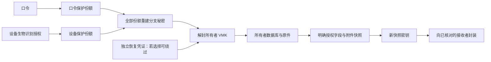

# 正式版密钥、恢复与接收者解密设计

> 状态：产品 D1～D3 已确认；密码学／格式与字段契约仍为草案\
> 版本：0.2\
> 日期：2026-10-03\
> 实现基线：`a86cec3`，Linux `codex/formal-foundation`\
> 执行规格：[安全设计任务](../../../tasks/specs/2026-10-03_密钥恢复与接收者权限设计.md)

## 1. 结论与适用范围

建议保留所有者运行库的随机 VMK、SQLCipher 与现有 Blob 加密边界，以新的解锁分支支持任一／全部方式；恢复使用独立随机凭证；接收者获得单独加密的授权快照，不获得所有者 VMK、运行数据库或所有者备份。以下是待评审方案，不改变已确认契约。

设计轮完成设计与实施拆分，未修改用户资料库或 Dart 实现。后续人类已选择 D1～D3 的推荐方案，并明确日常默认密码或指纹任一即可，不强制同时满足。K0 随后完成恢复事务与 Header 写入编码、76 项测试、Linux 原生及两端构建；见 [真实交付](../../../handoffs/2026-10-03_K0恢复事务与中断安全.md)。新的密钥／格式／字段契约仍需按具体实施任务完成评审，不能把产品确认写成这些功能已实现。

设计时基线如下（最新底层评估见下一段，默认创建仍 v1）：Header v1 只有一个密码槽；中文生成口令和自定密码是输入模式；Android 设备槽保存完整 VMK，能独立解锁；数据库 schema v4；Blob v1 以 VMK 加密；`.lvault` v1 是所有者运行库的认证备份。`recipientName` 和本机 Executor 预览不构成接收者认证或限定范围解密。

2026-10-03 K0 与职责整理已提交为 `9bb28e5`。K1 已进入 [受限底层评估实现](08_Header_v2底层格式与恢复编码.md)：固定 ASCII 编码、两个 OR 单凭证分支、独立 LRR1、整 Header MAC。正式创建／设备／新备份／恢复确认仍受后续验收约束；第 5 节一般图与 JCS 是更广候选，不把评估子集说成完整未来契约已经冻结。

## 2. 术语与不变量

下列术语用于本草案，新增模型仍为候选。正式释放语义继续由 [领域释放策略](../domain/04_信息释放与交接策略模型.md) 定义；这里不重定义层级。

| 术语 | 含义与边界 |
|---|---|
| 所有者身份 | 对本资料库拥有完整控制的主体；显示名称是资料，不是授权依据 |
| 接收者身份 | 与已核对的接收者公钥关联的稳定标识；亲属关系、邮箱或名称不自动授予权限 |
| 凭证 | 用于取得密钥材料的输入或设备授权；两个知识凭证不因此成为两个独立因素 |
| 解锁分支 | 一条能够解封 VMK 的路径；日常任一方式对应多个单凭证分支，全部方式对应一个多凭证分支 |
| 恢复凭证 | 单独生成、离线保管的恢复秘密；与日常中文口令、身份邀请、交接凭证分开 |
| 授权快照 | 在某次策略版本和数据版本下，仅包含明确准许字段及附件的固定副本 |
| 交接信封 | 针对一个接收者封装快照密钥的认证材料；投递条件与实际密码学解密条件须分别说明 |
| 协助者／Executor | 产品角色；不因为称谓就取得接收者密钥或所有者权限 |

必须维持：默认 Owner-only；名称修改不授权；协助录入不等于查看 Secret；接收者密钥不能打开所有者库；组织和来源关系不扩大权限；供应商和 Agent 不得到 VMK；普通设置不把模拟生命状态当作真实释放条件。

## 3. 威胁、能力与残余风险

等级：必须防是该切片验收门槛；尽量防须有具体措施；无法防是本方案明确不作保证；后续指独立能力任务。

| 攻击者持有／可做什么 | 等级 | 对应措施与验证 | 残余边界 |
|---|---|---|---|
| 复制运行库或所有者备份，没有有效凭证 | 必须防 | 密文数据、受封装 VMK、无明文临时库；G1、M1 | 暴露外层大小／数量；弱口令仍可被离线猜测 |
| AND 分支中只知道一个凭证，或只获一个份额 | 必须防 | 分别封装的随机份额；不能沿旧完整 VMK 槽旁路；G2、G3 | 每个口令份额的认证标签仍允许离线验证该口令猜测，不承诺熵简单相加 |
| 修改 Header、跨库调换槽、重复或扩大 KDF 参数 | 必须防 | 结构限制、上下文绑定、解锁后认证整个 Header；G4 | 认证不能恢复被删除的数据；合法旧 Header 回滚另论 |
| 修改交接包、替换接收者公钥、伪造所有者 | 必须防 | 双向公钥核对、固定所有者验签键、完整包绑定；R1、R4 | 首次身份核对渠道本身被攻破时不能建立真实人身份 |
| 收到自己的授权包，尝试读别人／未授权记录 | 必须防 | 每接收者独立快照与密钥，严格字段白名单；R2、R3 | 所有者主动纳入的文本或原件可能本身含敏感内容，必须预览 |
| 同名亲属／协助者获得账号入口 | 必须防 | 权限以核对后的密钥绑定，不以名字匹配；R1 | 无法阻止持钥人主动转交自己的秘密 |
| 投递服务器控制调度并提前发送已持有信封 | 无法防（单投递方模型） | 明示信任边界；首切片建议手动交付；R5 | 端到端加密防服务器阅读，不防服务器提前把可解密材料发给接收者 |
| 删除新版状态并重放有效旧 Header、旧授权包 | 尽量防 | 本机高水位记录与重复包检查；G5、R4 | 新设备／完整磁盘回滚无独立可信状态，无法保证识别有效旧版本 |
| 知道新密码已失效的旧密码，并持有旧备份 | 无法防（仅重封装模型） | 明示旧备份仍可被旧凭证打开；M4 | VMK 未变时旧 VMK 也能打开后续同 VMK 数据；真正撤销泄露 VMK 需全库换钥 |
| 进程被杀、断电或恢复中断 | 必须防（本地事务范围） | staging、恢复日志、提交点、可重复恢复；M2、M3 | 硬件介质永久损坏依赖设备外备份 |
| Root、Hook 或已控制解锁进程，读取会话 VMK | 无法防 | 记录运行时限制，缩短秘密生命周期 | 本模型不能隔离同进程攻击者；不宣称 Dart 可证明清除所有内存副本 |
| 日志、剪贴板、临时文件和截图 | 尽量防 | 日志脱敏、无秘密遥测、限时展示、临时明文排除；G6、R6 | 用户主动复制及平台截图限制不能绝对撤回 |
| 长期跨设备恢复、自动摇篮与独立条件保障 | 后续 | 协议、交付方与跨设备验收独立任务 | 未实现前不能显示为在线可用 |

## 4. 日常任一／全部解锁

### 4.1 候选比较

| 方案 | 优点 | 否决或推荐理由 |
|---|---|---|
| 每凭证分别封装 VMK，加 UI 要求全部验证 | 任一解锁简单 | 只能实现 OR；任一槽可直接取得 VMK，否决用作 AND |
| 顺序多层封装 VMK | 能要求各层密钥 | 顺序、错误定位及增删方式更复杂；作为备选，不选为当前内部模型 |
| 从多个口令直接拼接派生 VMK | 表面简短 | 与随机 VMK 和修改凭证只重封装的目标不符，否决 |
| 每分支随机秘密，n-of-n XOR 份额分别封装，再由分支秘密解封 VMK | 任一与全部使用统一模型，数据 VMK 不变 | 推荐候选；组合、认证上下文及旧槽清理必须验证，仍需安全复核 |

### 4.2 推荐密钥依赖

每个分支有独立均匀随机 32-byte `B`，用于经 HKDF 域分离后封装 VMK。单凭证分支存一个受保护的 `B`；多凭证分支生成 `n-1` 个独立随机 32-byte 份额，最后一个为 `B XOR S1 XOR ... XOR S(n-1)`。每份额只在对应凭证密钥下封装。只有恢复所有份额才能重建 `B` 并认证解封 VMK。

这是 n-of-n 方案，不提供任意 m-of-n 或自定条件表达式。缺失一个均匀随机份额时其他份额不足以确定 `B` 是该候选的数学依据，不等于整个协议已经安全审计。每次改变分支结构重新生成 `B` 与全部份额，不跨分支或版本复用份额、随机 nonce 或缓存。

口令密钥用带独立盐和显式参数的 Argon2id；设备份额由每次强生物识别授权的本机受保护密钥封装，设备侧不得保留能独立恢复完整 VMK 的兼容槽。高熵恢复／文件密钥用 HKDF 域分离，不能把 HKDF 当作低熵口令的成本强化器。[HKDF 定义](https://www.rfc-editor.org/rfc/rfc5869.html)和 [Argon2 参数选择](https://www.rfc-editor.org/rfc/rfc9106.html)是原语依据；本项目组合方案是设计推导。

图中的独立恢复旁路已由人类确认，具体编码／密钥格式仍是候选。接收者的路径从快照开始，不通向 VMK。

### 4.3 组合、取消与设备失效

候选模型支持：一个或两个知识凭证、一个设备凭证；OR 是所选日常方式的单凭证分支集合，AND 是一个包含全部所选方式的分支。中文口令与自定密码若同时配置，分别有盐、输入模式和槽 ID；同值不被宣传为加强了独立性。日常默认任一解锁已确认；两个知识凭证同时配置及未来可选 AND 的具体产品流程仍须设计。

| 日常策略 | 口令 P | 自定密码 C | 设备 D | 日常结果 |
|---|---|---|---|---|
| OR(P,D) | 正确 | — | 取消／失效 | P 分支成功 |
| OR(P,D) | 错误／缺失 | — | 有效 | D 分支成功 |
| OR(P,D) | 错误 | — | 错误／取消 | 失败，库保持锁定 |
| AND(P,D) | 正确 | — | 有效 | 成功 |
| AND(P,D) | 正确 | — | 缺失／设备遗失／取消 | 失败；若独立恢复允许旁路，进入明确的恢复流程 |
| AND(P,D) | 错误 | — | 有效 | 失败 |
| AND(P,C,D) | 正确 | 缺失／错误 | 有效 | 失败 |
| AND(P,C,D) | 正确 | 正确 | 有效 | 成功，不宣传为三个独立因素 |
| 任意分支 | 取消／超时 | 任意 | 任意 | 清除本次份额与暂存会话，不保存部分完成状态 |

Linux／Windows 未有经过验证的每次设备密钥授权能力，不允许配置需要 D 的新策略；保留状态入口，不静默用设备 PIN、文件或自动读取替代。跨设备恢复先解封所有者备份，再建立新设备绑定；不能复制旧设备份额并声称新设备可用。生物识别变更可能使设备密钥失效，必须用真实设备验证；Android 能力依据见 [Keystore 官方文档](https://developer.android.com/privacy-and-security/keystore)。

## 5. Header、认证与设备槽候选

建议 Header v2 包含 `vaultId`、`headerEpoch`、`keyGeneration`、`dailyPolicy`、`branches[]`、`recoveryPolicy` 和 `headerMac`。每分支有 `branchId`、用途、类型、顺序固定的因素描述与 VMK 封装；每因素有 `factorId`、输入编码／词表版本、KDF 参数或本机设备引用、份额封装。实际字段名、整数范围和编码在 K1 实现规格评审后冻结。

认证使用确定字节表示。推荐 JCS，但仅支持受限 schema：不含浮点，整数限制在安全范围；重复键、孤立代理字符、未知关键字段和未识别算法拒绝，数组顺序明确；二进制为严格 Base64url。JCS 的序列化依据是 [RFC 8785](https://www.rfc-editor.org/rfc/rfc8785.html)，不是普通 `jsonEncode` 自动具有的性质。

先生成分支／因素描述与全部参数，再对不含密文的描述计算 `descriptorHash`；份额封装 AAD 绑定用途标签、库 ID、密钥代次、Header epoch、branch／factor ID 和该描述哈希。VMK 封装 AAD 绑定同一图及分支；设备保护材料也绑定同一上下文。Header MAC 使用 VMK 派生的独立密钥，覆盖整个规范化 Header，唯独排除 `headerMac` 本身。恢复或日常分支得到 VMK 后，MAC 成功才允许打开数据库。

必须区分：认证后的图结构防篡改，不自动提供防有效旧版本回滚。设备 MAC／引用失配、设备槽不存在或设备认证取消均不能回退到旧全 VMK namespace。初始化和每次打开都校验完整策略，不允许“保留旧密码槽但 UI 隐藏”。

攻击者可先修改未认证参数，故任何 KDF 执行前都有格式、大小、因素数和参数上限。候选上限：Header 64 KiB、因素最多 3、日常分支最多 3 加一个恢复分支；只接受列入 profile 的参数组，未知组返回受控错误。现有 19 MiB／2 次／1 lane 仅作旧格式兼容；新格式的推荐参数要在 Android 最低目标及桌面设备测量后选定，本轮不静默提升。设计应单列允许的资源预算，超出预算不得卡死或自动降级。

设备契约改为 `protectFactor(context, share)`／`unprotectFactor(context, wrappedShare)`，只保护本分支份额；能力返回强度、每次授权、失效条件及可用状态。实际插件是否足够满足此契约属于 K2 实测，不能仅凭现有 secure storage API 判为完成。

2026-10-12 追加：本人确认改指纹开关属于例外——只验证当前主密码，不重新收集恢复凭证；设备因素按设备本地槽对待，从凭证图解耦。解耦前"策略更新重新收集全部保留凭证"对设备因素继续有效；解耦规格见 `tasks/specs/2026-10-12_K3设备因素解耦与指纹开关.md`。

由于新 epoch 与图哈希进入全部封装上下文，策略更新必须重新收集所有保留凭证并生成新分支；不能在用户只输入一个口令时宣称其他未知口令已完成重封装。取消或缺少保留凭证时不提交新策略。修改 OR 为 AND 还需要第 10 节所述数据换钥，不能只删除旧槽。

## 6. 独立恢复与自设密钥

### 6.1 恢复候选

| 选择 | 收益 | 代价／结论 |
|---|---|---|
| 独立恢复直接解封 VMK，绕过全部日常条件 | 遗失设备或日常凭证仍可恢复，符合长期资料连续性 | 推荐；持恢复凭证者拥有整库权限，需独立离线保存并明确告知 |
| 恢复也必须满足全部日常条件 | 日常 AND 在恢复时继续成立 | 任一所需设备或秘密永久遗失可能导致永久丢失；不能宣传为独立恢复 |
| 多人阈值或多个独立托管方恢复 | 可以分离单点秘密／投递信任 | 协议与生命周期复杂，首切片后置；不模拟成已实现 |

推荐恢复秘密 `R` 为 CSPRNG 生成的 32 bytes，经独立 HKDF 上下文封装 VMK；不是由日常密码推导，不复制中文日常口令。字串是同一 R 的表达形式，不是另一把恢复钥匙。

非中文候选表达：带版本前缀、校验码和分组的 43 字符无 padding Base64url，恢复解码为恰好 32 bytes。大小写敏感，字母、数字、`-`、`_` 是编码字母表，不承诺每个随机输出都有各类字符。校验码只帮助识别输入错误，不提供认证或增加熵。

中文候选表达：独立、固定、有授权来源的 2048 项词表；256-bit R 加 8-bit 校验映射为 24 个 11-bit 索引。允许重复词，保持固定位置与前导零，不用现有“无放回生成日常词组”算法。熵来自 R，24 词只是编码；不是宣称兼容 BIP39。词表版本必须永久保留，汉字输入严格匹配；拼音输入是否支持另作不歧义编码评审。当前没有该恢复词表授权和稳定编码，中文恢复仍不可上线；先保留真实未提供状态。

### 6.2 生命周期

设置恢复凭证先临时生成，展示并让用户回输确认，认证验证通过后才原子提交 Header；保存失败不宣布成功。恢复是明确的所有者路径，不能得到“接收者”身份或自动触发交接。

恢复后的库先进入仅限恢复的会话，要求设置新日常策略、确认新的恢复凭证，再提交新 Header／设备引用，清除旧设备槽。输出身份和库 ID 必须来自认证后的库，不能从未认证 Header 显示为可信。生成的新 R 使用新代次；旧 R 对新 Header 失效，但旧备份仍保留旧 R 和旧 VMK 的关系。

更换日常凭证只重封装不撤销已泄露的 VMK；因此“找回访问”与“密钥可能泄露后的全库换钥”是两个操作。后者须轮换数据库及所有 Blob 的加密密钥、备份标识和相关认证材料，另建任务，不能用改密码冒充。

### 6.3 自设密钥

建议首切片保持现有自定密码，额外密钥文件后置。若人类选择本轮支持文件，文件应是随机秘密而非任意照片／出生年份／用户选定字符串：版本、factor ID、32-byte 随机秘密、错误检测编码；不内嵌 VMK、库内容或权限。导入需严格解析并绑定选定因素，文件可以复制，等同持有秘密；首版若仅使用可复制文件，不宣称硬件不可导出因素。随机高熵字串是文件秘密的另一输入表达，不是自动多一重因素。

拒绝把可猜密保问题设为独立槽。提供密钥文件会增加读取、迁移、丢失与备份风险，须扩展 K1／K2 矩阵，不能仅加一个文件选择按钮。

## 7. 真实身份与提前入口

所有者显示资料、稳定 owner ID、接收者联系人和公钥绑定保存在加密库；设备外观偏好不存这些身份权限。接收者在自己的独立目录建立身份和本地受保护私钥，Owner 只持有接收者公钥；Owner 恢复秘密不是接收者私钥恢复方式。

建议使用不同用途的接收者加密键和所有者签名键。邀请中含协议版本、稳定 recipient ID、加密公钥及 key ID，先严格解析，再经双方当面二维码或另一可信渠道完整核对公钥指纹；显示名称可另改，不改变 ID 或密钥。接收者同样核对并固定所有者验签公钥。单纯在不可信邮件中收一个“自签名公钥”不能证明发送者身份；需要绑定过程和持钥证明。密钥轮换由已绑定旧键认证并再次核对，旧键不可用时走重新绑定，不能按同名自动替换。

公钥、邮箱和身份信息的具体存储 schema 属于后续身份任务，不能将当前 `recipientName` 自动迁移成已验证身份。旧策略需要 Owner 手动绑定接收者，并重新预览；迁移后没有确认的记录继续 Owner-only，不自动生成信封。

提前入口只显示本人的身份、已认证邀请和已经取得的有限状态凭据；单机离线时不宣称知道实时交接进度，也不显示未授权卡片是否存在。真实远程进度需要服务认证与最小化状态协议，另建任务。

必须分开 `OwnerSession` 与 `RecipientSession`：后者只能打开自己的包存储，不创建所有者 repository、不加载所有者 VMK、不把收件身份写入全库权限。接收者查看包不应通过现有 `_refreshUnlockedData()` 路径。

## 8. 接收者限定范围解密

### 8.1 候选与推荐

| 方案 | 评价 |
|---|---|
| 交付 VMK 和运行库，接收者 UI 筛选 | 数据可自行解密，违反已确认范围，否决 |
| 给每字段／对象独立运行时密钥并实时共享 | 可更细的在线授权，但改动数据 schema、索引和历史迁移广；后续有实时协作需求时再评估 |
| 复制若干 SQLite 页面／删行后的所有者库 | 页面、历史、空闲页及关系闭包可能含未授权内容，不选为权限边界 |
| 明确字段投影成独立快照，重新加密给单个接收者 | 推荐首切片；容易验证实际输出，不改运行库加密，但增加副本、附件重加密和重新生成成本 |

每个 `(recipientId, recipientKeyId, policyEpoch, snapshotId)` 使用新随机 32-byte 包密钥 `PK`。只将授权 DTO 和附件副本放入包，以 PK 的用途分离密钥加密，绝不复制原 VMK 封装、SQLCipher 文件或原 VMK 下的 Blob 密文供接收者复用。

收件封装推荐经 RFC 9180 HPKE Base 的单次上下文，将 PK 与不包含封装本身的 payload 摘要封装给已绑定的接收者公钥；首候选 suite 为 DHKEM(X25519, HKDF-SHA256)／HKDF-SHA256／AES-256-GCM。完整包由固定所有者签名键认证；推荐 Ed25519。HPKE Base 本身不认证发送者，所以不能省略验签与身份绑定；它也不提供跨包重放防护或接收者长期键泄露后的前向保密。[HPKE 规范及限制](https://www.rfc-editor.org/rfc/rfc9180.html)、[Ed25519 定义及测试向量](https://www.rfc-editor.org/rfc/rfc8032.html)为原语依据。本项目包协议是组合候选，尚未选定／验证 Dart HPKE 实现，不自拼 ECDH 代码当作合规 adapter。

### 8.2 字段与关系边界

下表是待领域评审的投影建议；现有释放层级语义仍有效，字段扩展未经确认不写回 [领域定义](../domain/04_信息释放与交接策略模型.md)。不把枚举 ordinal 当成“层级以上自动全给”。

| 授权输入 | 快照候选输出 | 禁止默认夹带 |
|---|---|---|
| hidden／无策略／接收者未绑定 | 不产生条目 | 标题、ID、数量提示或关系存在性 |
| existence | Owner 已预览的名称与存在提示 | 正文、账号、附件名、来源链 |
| summary | 单独由 Owner 选择／确认的摘要字段 | 直接截取前 80 字，或假定短正文可全给 |
| full | 明确确认的完整一般卡片内容；凭据字段逐个列明 | Secret、原件、历史、回收记录以及凭据 UI 的隐含 fallback |
| secret | 明确授权的当前秘密及必要账号上下文 | 原件、旧密码修订、其他条目或 Agent 访问权限 |
| original | 列明并单独确认的原件附件与其文件名／类型 | “original 枚举大于 secret，所以默认给密码”；未经授权来源及其他卡片 |

目前领域开放问题尚包含 Secret 与原件是否独立开关；建议为真实交接引入明确字段／附件集合，并保留原层级作为产品呈现。若不能在本轮完成该语义评审，首个包切片仅允许 Owner 手动选择和预览投影、明确手动交付，不冒充已经实现完整自动生命状态释放。

策略不沿来源、盒子、组合成员或历史自动扩展。只引用已授权对象；未授权关系删去，不保留隐含 ID 或占位。历史与回收内容默认排除；版本中只有当前已授权字段参与快照。原件可能含密码、其他人的信息或不同范围内容，若本身不能分割授权，必须作为整个文件单独预览和确认，不能靠 DTO 字段过滤承诺原件内脱敏。

包不保留全库真实内部 ID；使用包内 ID 和明确获准的关系。所有者内部保留原 ID→包 ID 对应审计记录；接收者看到的 provenance 仅是已授权的最小来源说明，未授权源名称、原文、哈希及记录数量不外泄。

### 8.3 快照一致性与信封候选

导出在所有者锁定的快照事务／写操作排他窗口下，固定数据版本与策略版本。读取 DTO、附件标识和哈希到受控内存；附件密文路径不可被外部替换，重解密并核对原件哈希后重加密。存在并发修改则中止并重试；记录 snapshotId 和策略 epoch，绝不混合新正文和旧权限。不在磁盘生成所有者明文数据库或附件；首版沿用受控大小上限，超限显式拒绝，大文件流式独立设计。

建议独立格式暂称 `lrhandoff` v1，文件后缀和规范尚未冻结。它不同于 `.lvault` 所有者备份：

- 外部 descriptor 只含 magic／版本／算法 suite、随机 packageId、接收者 key ID、验签 key ID、包内 entry ID 和计划密文分项长度；不含密文内容哈希、姓名、邮箱、库标题、正文或全库内部 ID。数量、总长度与 key ID 可关联性仍会暴露，记录该风险。
- 内部加密 manifest 含库绑定、snapshotId、recipientId、接收者 key ID、policyEpoch、包序号、来源说明、字段白名单、获准附件、生成时间、交付模式和各项摘要；由 PK 派生的 manifest 密钥加密。
- 先固定 manifest／DTO 明文字节、附件与加密分项布局，据已知长度生成结构 descriptor；每个 DTO／附件使用独立用途密钥和唯一 nonce，AAD 绑定格式、descriptor 摘要、packageId、entryId 与类型。生成密文后，计算仅由 descriptor 摘要和各密文分项哈希组成的 `payloadDigest`。包键的 HPKE info／AAD 绑定 descriptor 摘要、payloadDigest、接收者键和上下文域标签。
- 最后构建含 descriptor 摘要、payloadDigest、HPKE `enc`／封装内容摘要的规范化签名输入。Ed25519 对域标签加该规范字节签名；不是自行把 Ed25519 的预哈希模式混用。密文哈希不进入其自身 AAD，封装内容与签名也不进入自身依赖摘要，避免循环依赖。
- 接收端先检查体积、条目数、路径、重复键与 suite，再按已固定公钥验签，验证 recipientKeyId 和密文摘要，HPKE 解封 PK，验证内部 manifest，最后逐项解密并核对字段／附件集合。不得在验证完成前导入或展示任何条目。

HPKE 封装、签名与密文的精确字节编码和限制需在 R1 规格中固定为 golden vectors；这里只规定安全依赖，不宣称已可互操作。

### 8.4 条件、撤销与版本

推荐首切片只支持本人明确生成并手动交付。日常自动预备包可只存 Owner 侧，但服务未接入前不显示已托管或已触发。

未来服务器可以持有不能读取的收件信封，但只要它能投递完整可解密材料，就能够提前投递；收件端校验一个 `notBefore` 时间或生命状态枚举不能阻止恶意持钥接收者自行解密。若产品要求投递方不能单独提前释放，应引入独立释放秘密／独立批准者等真正缺失的密钥条件，再另论阈值、协作失效和救济；本轮不提供未经论证的“服务器安全锁”。

策略缩减生成新 packageId、新 PK、新 epoch，停止后续投递旧包；需要服务配合删除投递队列，但不能保证收回离线副本。接收端保存每个已绑定 Owner／库／接收者组合的最高已见包序号及包 ID：同包作为幂等重复，低序号不自动覆盖新包；全新设备不知道历史高水位，仍可接受有效旧包但必须提示缺少新鲜性证明。加密时间戳不是可信时钟或防回滚证明。

收件键丢失只影响该接收者；Owner 需重新核对新键并重发包，原包不能靠 Owner 恢复凭证直接解封。接收者长期私钥泄露可能解开所有向该键封装的历史包；建议轮换未来绑定并停止旧键投递，但不承诺历史前向保密。

## 9. 内部契约候选

契约输入的秘密仅存在于操作范围，输出会话句柄而非将 VMK 返回给 UI。core 可在内部使用字节，调用者负责关闭句柄与清理；不承诺运行时不存在隐含副本。以下为候选，并非当前已实现 API。

| 操作 | 输入／前置 | 输出／行为 |
|---|---|---|
| `createOwnerVault` | 新目录、选定策略、全部凭证、已回输确认的 R（若启用） | 原子建立库、Header、设备引用，返回 OwnerSession；已有库拒绝覆盖 |
| `unlockOwner` | 有界 Header、选定分支、对应凭证 | Header 验证后返回 OwnerSession；缺失不打开数据库 |
| `planPolicyChange` | OwnerSession、新策略、全部保留／新增凭证 | `RewrapPlan` 或 `DataRekeyRequired`；不能静默把强化策略变成只重封装 |
| `commitPolicyChange` | 完整新方案、再次满足旧日常分支或明确恢复分支、已确认 R | 原子提交新 epoch；需要换 VMK 时交给换钥任务，不在此处假装完成 |
| `beginRecovery` | 独立 staging／库、R、可信格式能力 | RecoverySession，只允许核验与重建安全配置；不自动确认新凭证 |
| `finishRecovery` | RecoverySession、全部新日常凭证、新 R 的回输确认 | 提交后转 OwnerSession；失败留旧可恢复状态，清理临时材料 |
| `bindRecipient` | OwnerSession、通过可信渠道核对的 ID／键、持钥证明 | 可撤销的 recipientKeyBinding；旧名字策略不自动变为绑定 |
| `buildRecipientSnapshot` | OwnerSession、已绑定接收者、显式批准的字段／附件集、策略／数据期望版本 | 仅包含该范围的 SnapshotHandle；版本变化中止，不返回未过滤 repository 对象 |
| `sealRecipientPackage` | SnapshotHandle、接收者绑定、Owner 签名能力、手动交付确认 | 独立加密包和交付审计信息；不输出 VMK、R 或收件私钥 |
| `openRecipientPackage` | 有界包、RecipientSession、已固定 Owner 公钥 | 完整认证后返回 RecipientSnapshotSession，只访问包内集合 |

错误枚举候选：`Cancelled`、`CredentialsRejected`、`FactorUnavailable`、`DeviceKeyInvalidated`、`UnsupportedVersion`、`UnsupportedSuite`、`ResourceLimit`、`MalformedInput`、`AuthenticationFailed`、`RecipientMismatch`、`IdentityUnverified`、`PolicyChanged`、`RekeyRequired`、`StorageFailure`、`RecoveryInterrupted`。用户错误在密码错误与密文损坏无法可靠区分时合并；内部诊断不输出秘密、解密内容、输入口令或可关联联系人。

版本和安全要求：未知版本失败关闭；新格式不降级写旧格式；不允许把恢复／身份／授权错误当作生物识别缺失后自动改用其他路径；所有外部包与 Header 先受资源限制，再计算 KDF／验证，避免恶意输入放大成本。线程与调用重入必须串行化同一库的修改，取消必须结束事务并关闭句柄。

## 10. 格式兼容、迁移与回滚

### 10.1 版本矩阵

| 输入／操作 | 计划行为 | 不允许的行为 |
|---|---|---|
| Header v1 中文或自定密码库 | 原路径继续读取；显式选择升级前不写 v2 | 首次打开自动换密码或重建库 |
| v1 → v2，等价 OR／单密码策略 | 核验旧凭证、建立新 Header 和槽；可保持 VMK，数据库／Blob 格式不变 | 隐式把旧设备键绑定成新已验证身份 |
| v1／v2 OR → AND，或移除能够独立解锁的恢复路径 | 必须换 VMK、重加密数据库及全部 Blob，才对后续数据加强限制 | 仅删旧槽但仍沿用旧 VMK，并宣称旧密码／旧备份不能解新数据 |
| v2 普通口令修改、同边界重封装 | Header epoch 增加，旧新因素完整核验，VMK 可保持 | 宣称改密码撤销攻击者已知 VMK |
| v2 含设备 AND 的跨设备恢复 | 必须有已确认独立恢复路径，恢复后新建本机槽 | 将已失效设备密钥自动视为满足条件 |
| `.lvault` v1 | 新版继续验证 v1 清单及旧 Header；独立 staging 打开 | 未验证就替换当前库 |
| Header v2 所有者备份 | 建议 `.lvault` v2，显式记录 Header profile、库 ID、密钥代次与完整附件清单；旧读者明确拒绝 | 用同为 v1 的外层隐藏不兼容的新 Header，或输出缺失附件且标完整 |
| Blob v1／schema v4 | 重封装不改数据；VMK 换钥重写密文但可保持 Blob v1 与 schema v4 | 把换钥误写为仅 Header 版本升级 |
| `lrhandoff` 候选 v1 | 专用接收者读取器，不进入所有者恢复流程 | 以 `.lvault` 还原获得 Owner 权限 |
| 未知版本／算法／损坏输入 | 有界检查后受控拒绝，保持原库 | 自动降级、默认参数解读、丢弃原库 |

选择 AND 时必须解释旧数据副本的限制：换 VMK 只能防旧 VMK 解开换钥后的新密文，不能收回旧备份的旧数据。强化权限的换钥另列 K4；K4 未完成前，旧库的 AND 升级入口不可用，新建库 AND 仍可在其前置验证通过后实现。恢复旁路若启用，AND 始终只描述日常分支。

### 10.2 本地事务

Header 写入不能采用当前“先删除旧 Header，再 rename 临时文件”并认为全程安全。建议写新 generation 文件、flush、验证再提交指向 generation 的原子选择记录；实现需验证各目标文件系统的 rename 与目录持久化语义，不宣称 Dart `flush` 等同所有平台断电持久保证。

恢复／换钥采用同文件系统的 staging、旧库 rollback、受限操作日志和明确提交点。日志只保存版本、随机 operationId、限定相邻目录名、动作阶段和输入密文摘要，不保存 VMK、口令、R 或联系人；路径必须由程序生成并验证，不能从外部归档或可篡改日志读任意绝对路径后删除。

| 中断位置 | 重启处理与可用性 |
|---|---|
| 新 Header／staging 未完整写完 | 当前库保持原状，弃用未验证输入；可用原凭证解锁 |
| staging 已验证，当前库尚未移动 | 原库可继续解锁；可重新发起恢复，不自动采用来源不明的 staging |
| 原库已移动，尚未安装 staging | 根据受限日志找到 rollback，恢复原路径或引导认证；不得创建空新库 |
| staging 已安装但未确认提交 | 暂停正常解锁路由，认证候选库和日志一致性后选择完成或回退；不能仅看目录存在就删除 rollback |
| 提交成功，rollback 清理失败 | 新库正常使用；保留加密 rollback 并提示可清理，不回滚已完成导入 |
| 日志损坏、缺失且有多个残留目录 | 不自动猜库、不删除；进入受控恢复状态，允许认证备选副本 |

数据库打开、迁移、认证清单及附件核对全部成功后才提交。换钥创建新的 SQLCipher 数据库并迁移逻辑数据，逐个解密并在新 VMK 下重加密 Blob，保留逻辑引用、使用新 nonce；不要对旧数据库原位改钥再声称可回滚。恢复出来的旧版本永远保留其实际权限语义，不显示为当前 AND 配置。

设备槽更新采用新引用先准备、验证，Header 提交后清旧引用；失败与中断按日志恢复。涉及 OR→AND 的升级必须确认旧完整 VMK namespace 清理及数据换钥完成，不能在删除失败时标记强化成功。SSD／文件系统与备份中的旧密文无法证明物理擦除，记录为历史副本风险。

## 11. 验收与验证矩阵

这些是未来自动化／实测要求。本次仅做源码、设计一致性和文档检查，未声称运行密码学测试或安全审计。

| ID | 场景 | 必须证明的结果 |
|---|---|---|
| G1 | v1 中文／自定库与 v2 新建库，磁盘扫描 | 密码、VMK、R、DTO 和原件无明文临时输出；原有创建校验仍成立 |
| G2 | OR／AND 的全部、缺一个、错误一个和取消组合 | 成功矩阵与第 4 节一致；失败无可用 VMK、无部分持久会话 |
| G3 | 手工绕过 UI，访问新旧设备 namespace；提供旧 Header／备份和单凭证 | 新 AND 数据不被旧 VMK 打开；未完成换钥时拒绝升级；同 keyGeneration 的旧副本边界明确 |
| G4 | 改 salt／profile／用途／库 ID／因素 ID／epoch／MAC／nonce，超限输入 | 不打开库；非法参数在 KDF 前拒绝；无密钥或输入内容日志 |
| G5 | 重放有效旧 Header／完整磁盘回滚／新设备无高水位 | 已见旧版不静默覆盖；无可信历史时不声称可证明最新 |
| G6 | 锁定、超时、失败、系统后台、保存失败 | 句柄关闭、已持有份额释放、缓存清理，失败不标已保存 |
| G7 | Android 新录入／移除指纹、设备失效、取消、进程重启；Linux／Windows 无实现 | 每次设备授权实际生效；AND 不降级；未支持设备状态真实 |
| G8 | R 错误／校验错误／新旧 R、回输失败、日常凭证丢失 | 恢复范围与产品选择一致；旧备份事实保留；新 R 未确认不提交 |
| R1 | 同名不同键、身份邀请篡改、首次绑定／换键／未核对 | 无名称授权；未核对键不能生成真实包；接收端固定 Owner 键 |
| R2 | 每层字段、Secret、原件及无策略；共享字面敏感摘要 | 包内字节只含批准集合；未确认摘要不直接截取原文；原件整文件风险可预览 |
| R3 | 历史密码、回收、来源、盒子、组合成员、他人包、跨库错绑 | 不沿关系扩权；隔离接收者实例没有 Owner repository 或 VMK，非授权数据不能解密 |
| R4 | 伪造密文／签名／信封、重放、排序与重复条目、超限路径 | 验签、绑定与所有摘要成功后才展示；重复幂等，已见旧包不覆盖 |
| R5 | 恶意投递方提前发送、篡改本机时间、持钥接收者自行解密 | 单投递方风险可复现并如实标识，不以 UI 倒计时宣称强制条件 |
| R6 | 并发编辑、修改策略、附件变化／损坏、中途锁定 | 原子快照或失败重试；无混合版本、明文临时附件与泄露日志 |
| R7 | HPKE／签名／规范化独立实现与官方向量 | suite／序列化字节一致；端到端互操作，错误 suite 明确拒绝 |
| M1 | 中文／自定、设备启用／禁用旧库与旧备份组合 | 未升级继续使用；恢复后清设备绑定，名字策略不自动认证 |
| M2 | 每次写入、flush、rename、安装、提交、清理故障及进程重启 | 至少一份可认证库保留；不会自动创建空库；失败使用正确旧／新凭证 |
| M3 | 恶意／损坏日志、非相邻目录、多个 rollback，数据库迁移失败 | 不任意删改目录；未认证副本不被标可信；正常会话被受控阻止 |
| M4 | 改密码、减少 OR、OR→AND、R 撤销及旧密钥／备份攻击 | 明确何时换 VMK；新密文按承诺拒绝旧 VMK，旧数据无法收回的限制不隐藏 |
| M5 | Header／Blob／归档未知版本、旧 reader、新 receiver | 拒绝兼容范围外输入，原库不变；接收者包不成为所有者恢复入口 |

密码学组合评审与 golden vectors 不由 widget 测试代替；设备绑定／崩溃恢复用原生集成和目标系统实测。构建与原生集成顺序运行，使用虚构库和独立目录。

## 12. 产品待定项与实施顺序

| 决策 | 推荐 | 必须明确的影响 |
|---|---|---|
| D1：独立恢复是否绕过全部日常条件 | 已确认允许；设置中说明持 R 可恢复整库 | 日常默认 OR（密码或指纹），不强制密码＋指纹；未来可选 AND 仍需完成其安全与迁移验证 |
| D2：本轮自设密钥范围 | 已确认先自定密码，随机文件／字串密钥后置 | 不将未来文件能力显示为已提供 |
| D3：首个真实交接的交付与条件范围 | 已确认本人明确授权并手动交付；自动摇篮后置 | 手动授权是独立显式授权记录，不借用模拟生命状态；具体字段／身份契约仍需评审 |

D3 不是用手动按钮代替密码学条件。真实自动交接若继续采用一个持完整信封的投递方，必须接受该方可提前投递的信任边界；若不接受，先完成独立释放条件设计再编码服务。字段映射、多接收者和原件授权由领域定义所有者评审，本草案没有私改正式领域文档。

建议执行顺序：

1. K0：旧格式 Header／恢复事务与中断处理。契约和加密参数不变，可独立实施；见 [恢复事务任务](../../../tasks/specs/2026-10-03_旧库恢复事务与中断安全.md)。
2. K1：按已确认 D1／D2 完成 Header v2 字节规范，先验证默认 OR、独立恢复和兼容读取；可选 AND 组合留到 K4。
3. K2：Android 因素保护与设备失效实测，再接安全设置 UI；桌面设备因素另适配，不假装可用。
4. K3：独立恢复／Header v2 所有者备份与身份资料。中文恢复编码先补词表授权及样本；旧库不自动认证接收者。
5. K4：可选 AND 份额组合、全库换钥与强化权限迁移，G2 的 AND 部分及 G3／M4 通过后才提供对应入口。
6. R1：明确 D3 及字段集合、选择可验证 HPKE adapter，实现隔离授权快照和接收者包；实际条件服务再单独设计。

任务边界、文件所有权与测试要求见 [实施拆分](../../../tasks/specs/2026-10-03_正式版密钥与交接实施拆分.md)。K1～R1 尚待对应方案评审，不因本文件已存在而变为可直接改冻结契约的授权。

这里有实质候选和取舍，但尚未形成已接受的重要决定；本轮不新增“已接受”ADR。方案接受后将快照交接和密钥分支选择的理由写入论证充分的 ADR，并互链到本文件和受影响正式设计；其反转条件是出现必须支持实时协作／细粒度在线共享的需求，或组合评审指出安全／可恢复性缺陷。

## 13. 来源与核验记录

本地事实核对日期为 2026-10-03：`vault_key_manager.dart`、`app_controller.dart`、`biometric_key_store.dart`、`android_biometric_key_store.dart`、`app_database.dart`、`encrypted_blob_store.dart`、`life_vault_archive.dart`、`chinese_passphrase.dart`、`entities.dart` 与 `release_preview.dart`。不在本草案复制长期实现说明；基线变化后按任务重新核对。

产品和正式设计依据：[已确认范围](../../20_product/16_正式版演进与已确认范围.md)、[密钥体系](03_密钥与加密体系.md)、[LifeVault](02_LifeVault总体设计.md)、[恢复](05_LifeVault导入导出与恢复.md)、[角色](../handoff/01_角色模型.md)及领域释放定义。

外部原语／平台依据已于同日在线核验：RFC 5869、9106、9180、8785、8032 与 Android Keystore 官方说明，直接链接见相应章节。它们支持原语行为和平台边界，不代表 LiveRelay 组合方案经过审计，也不证明现有 Flutter 插件实现满足新契约。

## 本机优先实现落点（2026-10-03）

人类已明确优先完成本机六组软件流程，并将云端、语言与优化后置。K3／K4／R1 的本机最小完整路径已按独立 v3工程格式、整库换钥、独立接收者身份／签名限定快照、本地分层备份落地，具体格式见安全10／11。身份绑定支持完整指纹核对与两把私钥的挑战证明；手动交付不依赖模拟生活状态。远程撤销／摇篮条件、硬件单调回滚、自动交接及多设备冲突仍未实现；不把本机完成记作完整正式安全验收。
